# Robot Shop Observability on EKS

Metrics, logs, a trace, an availability SLO with an alert, and an incident write-up for the [Instana Robot Shop](https://github.com/instana/robot-shop) sample application, running on AWS EKS.

The shop itself is not built or hardened here. Its images are third-party and run as they are. Everything around it is what this repository adds, and the whole environment rebuilds from code: one pipeline run for the cluster and one script for everything inside it.

## What was built

| # | Task | Result | Evidence |
|---|---|---|---|
| 1 | Robot Shop and load | 12 shop workloads plus a load generator, all Running and ready. Public ALB. Traffic visible in the web logs. | `01-pods-healthy.png`, `02-shop-frontpage.png` |
| 2 | Metrics | One Grafana dashboard, loaded from a ConfigMap. Availability and p95 latency come from blackbox probes, status codes and the 5xx ratio from the web access logs. Cart and payment business metrics are scraped through a PodMonitor. | `03-prometheus-targets.png`, `04-probe-metrics.png`, `05-dashboard-healthy.png`, `06-dashboard-incident.png` |
| 3 | Logs | Fluent Bit on every node ships to Loki. Searchable in Grafana by `service` and `level`. | `07-loki-logs-by-service-level.png` |
| 4 | Trace | The OpenTelemetry Operator injects the Java agent into `shipping`. One request is visible end to end in Jaeger (`GET /codes`, 5 spans). | `10-jaeger-search.png`, `11-jaeger-trace-codes.png` |
| 5 | SLO | Availability SLO, one-page error budget policy, and a burn-rate alert proven through Prometheus and Alertmanager. Slack delivery is not configured (see limitations). | `08-alert-prometheus.png`, `09-alert-alertmanager.png` |
| 6 | Incident | A self-caused outage (a failed attempt to instrument cart) was mitigated, diagnosed from Loki and written up. Instructor-run drill: did not take place, see Deviations. | [runbook](incident/runbook.md), [postmortem](incident/postmortem-2026-11-10-cart.md) |

Screenshots live in `docs/screenshots/`.

## Evidence

**1. Shop and load**

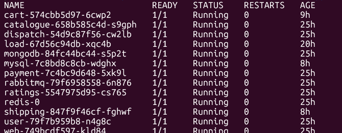
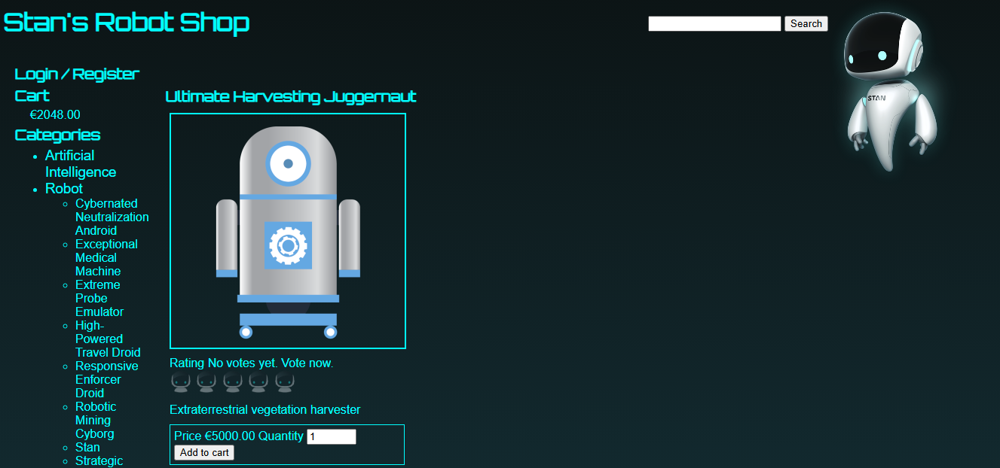
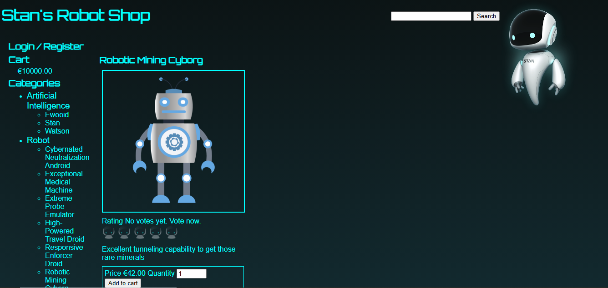

**2. Metrics**

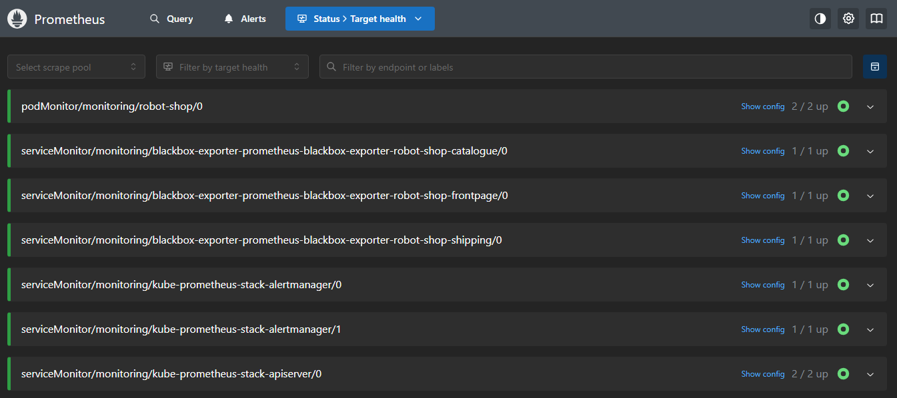
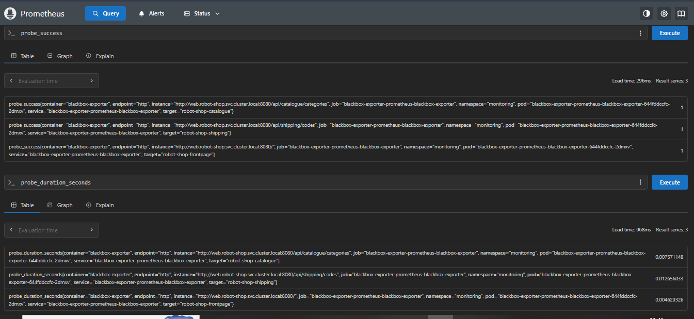
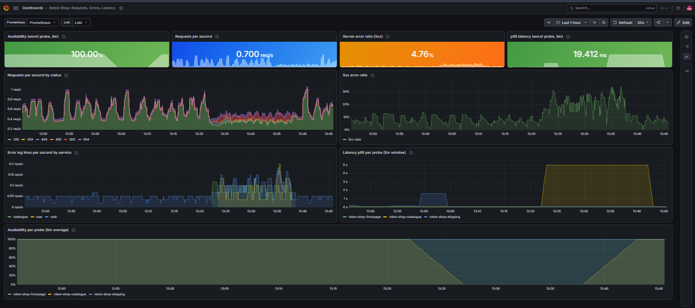
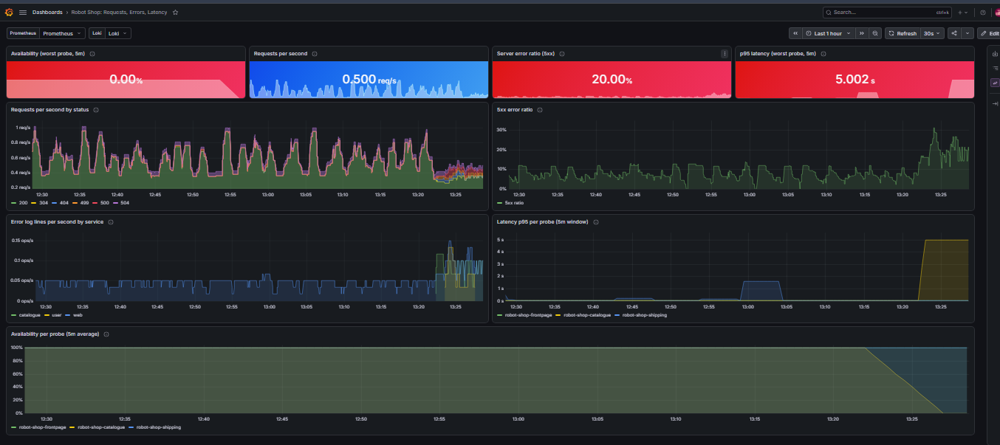

**3. Logs**

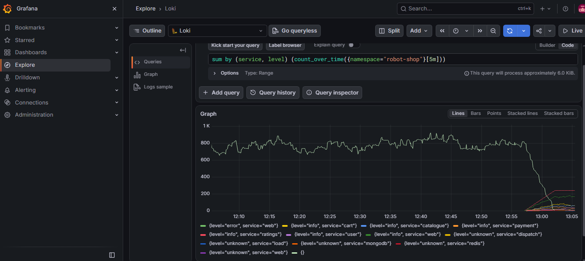
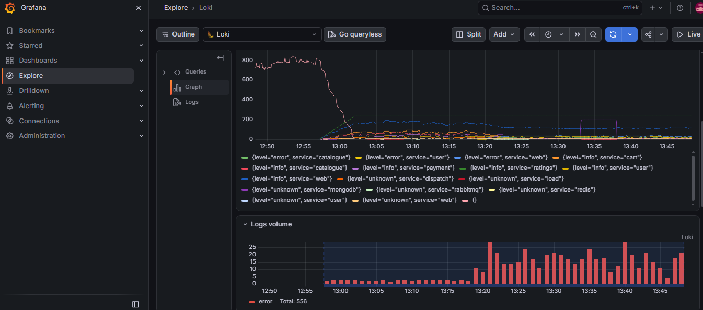

**4. Trace**

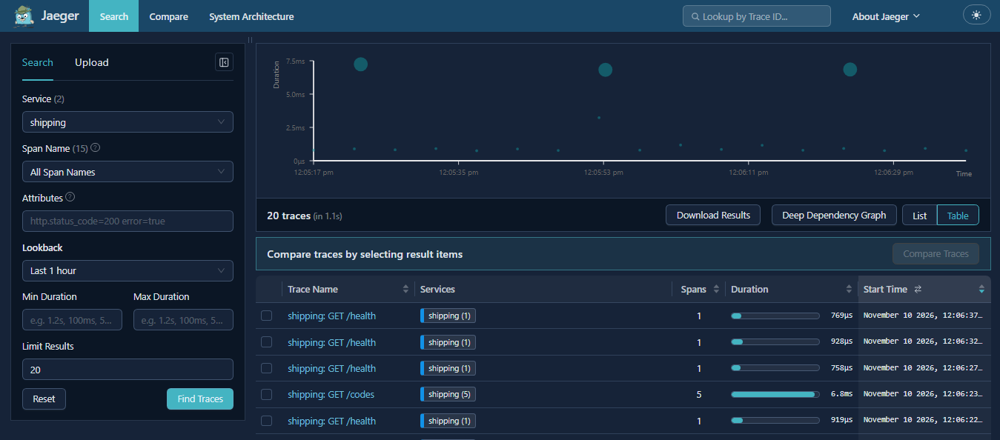
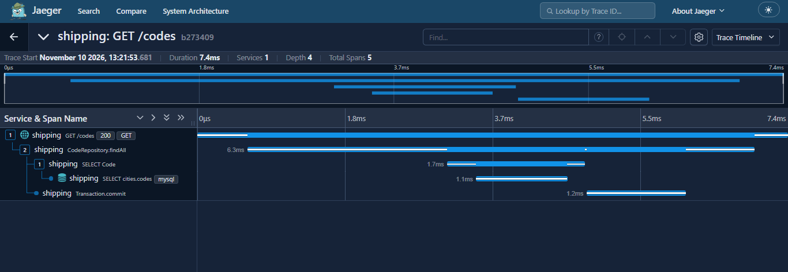

**5. SLO alert**

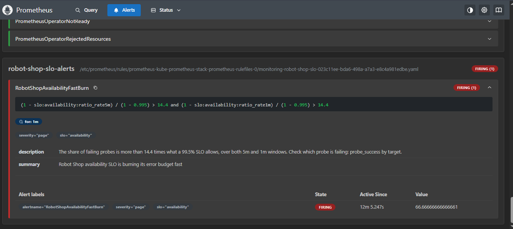
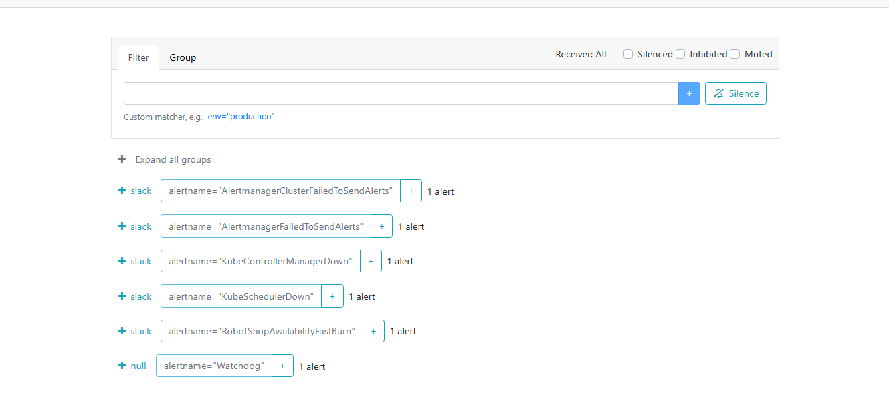

## Architecture

```
load generator ──► web (nginx) ──► cart, catalogue, user, shipping, payment, ratings, dispatch
                                            │
                                            └──► MongoDB, MySQL, Redis, RabbitMQ

blackbox exporter ── probes front page, catalogue, shipping ──► Prometheus ──► Grafana, Alertmanager
PodMonitor ── cart and payment /metrics ───────────────────────┘
Fluent Bit (every node) ──► Loki ──► Grafana (logs by service and level)
shipping + OpenTelemetry Java agent ──► Jaeger (OTLP over HTTP)
```

| Concern | Tool |
|---|---|
| Cluster | EKS, three `m7i-flex.large` nodes in the default VPC, EBS CSI driver, encrypted `gp3` storage |
| Metrics, dashboards, alerts | kube-prometheus-stack (Prometheus, Grafana, Alertmanager), blackbox exporter |
| Logs | Fluent Bit and Loki (single binary) |
| Tracing | OpenTelemetry Operator and Jaeger |
| Public entrance | AWS Load Balancer Controller, one ALB for the shop |
| Infrastructure pipelines | GitHub Actions with AWS access through OIDC, approval gates on apply and destroy |

## Repository layout

```
.github/workflows/    infra (plan), infra-deploy, infra-destroy (+ verify job)
infra/eks/            Terraform for the cluster
infra/github-oidc/    Terraform for GitHub's OIDC provider and the pipeline roles (applied once)
scripts/              bootstrap-state, deploy, destroy, verify-destroyed, install, uninstall
platform/             gp3 StorageClass
robot-shop/           upstream Helm chart (pinned commit), our overrides, ingress, load generator
monitoring/           Prometheus and Grafana values, blackbox probes, PodMonitor, dashboard JSON
logging/              Loki and Fluent Bit values (level extraction lives in the Fluent Bit values)
tracing/              Jaeger, OpenTelemetry Operator and Instrumentation
slo/                  SLO rules, error budget policy, Alertmanager values, example Slack secret
incident/             runbook, postmortem template, postmortem of the cart outage
docs/screenshots/     evidence for the table above
```

## Run it in your own account

1. **Account.** Use an AWS account where you can create IAM, S3, EKS, EC2, ELB, KMS and CloudWatch Logs resources in `us-east-1`. Create an admin IAM user with MFA and configure the CLI. Some organizations restrict these services with service control policies, so ask your administrator if a call is denied.
2. **State bucket.** `./scripts/bootstrap-state.sh` creates the Terraform state bucket (its name contains the account number). Put its name and the state keys into `infra/eks/backend.hcl` and `infra/github-oidc/backend.hcl` (copy from the `.example` files).
3. **Pipeline access.** In `infra/github-oidc`, set `create_oidc_provider = true` in a git-ignored `terraform.tfvars` (use `false` if the account already has GitHub's provider), set `github_repo_sub` to your repository's identity, then:
   ```bash
   cd infra/github-oidc
   terraform init -reconfigure -backend-config=backend.hcl
   terraform apply
   terraform output
   ```
   In this account the token subject contained numeric IDs (`repo:OWNER@OWNER_ID/REPO@REPO_ID`), which the first version of the trust policy did not match. If a workflow fails with "Not authorized to perform sts:AssumeRoleWithWebIdentity", compare the token's `sub` with the role's trust policy.
4. **GitHub settings.** Create the environments `production` and `app-production` (required reviewer, `main` only). Add these repository **variables**: `AWS_REGION`, `TF_STATE_BUCKET`, `AWS_PLAN_ROLE_ARN`, `AWS_APPLY_ROLE_ARN`, `AWS_DEPLOY_ROLE_ARN`, `ADMIN_USER_ARN`.
5. **Cluster.** Copy `infra/eks/terraform.tfvars.example` to `terraform.tfvars` for local runs. Then run **Actions, infra-deploy** and approve it (about 15 minutes).
6. **Everything inside the cluster.** Optionally export a Slack webhook, then run the installer:
   ```bash
   read -rsp "Slack webhook (optional): " SLACK_WEBHOOK_URL; export SLACK_WEBHOOK_URL
   ./scripts/install.sh
   ```
   It installs the storage class, the load balancer controller, Prometheus and Grafana, Loki, Fluent Bit, Jaeger, the shop, the load generator, the ingress, the blackbox probes, the dashboard, the SLO rules and the OpenTelemetry setup. Every step is repeatable.

### Looking around

```bash
kubectl get ingress -n robot-shop                                            # the shop's public address
kubectl -n monitoring port-forward svc/kube-prometheus-stack-grafana 3000:80  # Grafana, user admin
kubectl -n monitoring get secret kube-prometheus-stack-grafana -o jsonpath='{.data.admin-password}' | base64 -d; echo
kubectl -n monitoring port-forward svc/kube-prometheus-stack-prometheus 9090:9090
kubectl -n monitoring port-forward svc/kube-prometheus-stack-alertmanager 9093:9093
kubectl -n tracing port-forward svc/jaeger 16686:16686                        # Jaeger UI
```

In Grafana, Explore with Loki: `{namespace="robot-shop", service="cart", level="error"}`. Stack-trace lines carry `level=unknown`, so search `level=~"error|unknown"` during an incident.

## SLO

- **SLI:** the share of successful blackbox probes across the front page, the catalogue and shipping, checked every 30 seconds from inside the cluster.
- **SLO:** 99.5% over 30 days. The error budget is 0.5%, about 3.6 hours.
- **Alert:** `RobotShopAvailabilityFastBurn` fires when the budget burns at 14.4 times the sustainable rate or faster. A production setup would use 1 hour and 5 minute windows. The lab uses 5 minutes and 1 minute so the alert can be demonstrated, and the policy explains the difference.
- **Policy:** [`slo/error-budget-policy.md`](slo/error-budget-policy.md).

## Incidents

[`incident/runbook.md`](incident/runbook.md) is the first-response sheet. [`incident/postmortem-2026-11-10-cart.md`](incident/postmortem-2026-11-10-cart.md) covers the cart outage that followed an attempt to instrument a Node service, including a mitigation mistake (running `rollout undo` twice).

## Tear down

Run **Actions, infra-destroy**, type `destroy`, and approve. The workflow uninstalls the Helm releases, deletes ingresses and volume claims, waits until the load balancers and volumes are gone, destroys the cluster, and then a `verify` job runs `scripts/verify-destroyed.sh` with the read-only role. To check by hand:

```bash
CLUSTER_NAME=robot-shop ./scripts/verify-destroyed.sh
```

The tag-based part of the check can briefly list volumes that were already deleted, because the tagging index lags. The script looks each volume up directly and passes it when EC2 says it does not exist.

## Deviations from the brief

- **Slack.** The brief asks for one alert sent to Slack. No workspace was available, so the alert is delivered to Alertmanager only (`08-alert-prometheus.png`, `09-alert-alertmanager.png`). `install.sh` accepts `SLACK_WEBHOOK_URL` and creates the secret, and Alertmanager loads the Slack receiver, but no message was ever delivered.
- **OpenTelemetry config.** The instructor's config was not available. Tracing uses the OpenTelemetry Operator's auto-instrumentation with an `Instrumentation` resource written for this project, on `shipping` only.
- **Incident drill.** The Instructor-run drill did not take place, instead a self-caused outage (a failed attempt to instrument cart) was mitigated, diagnosed from Loki and written up.

## Known limitations

- **Only `shipping` is traced.** Instrumenting cart with the Node agent put it into a crash loop. The stack trace passes through the injected agent's loader and uses old-style Node paths, which points to a Node runtime too old for the agent (cart runs Node v14.17.5). Catalogue and user were not tried.
- **The SLI does not cover cart.** A cart outage shows up in errors and logs but not in the availability SLO. A cart probe is the next addition.
- **The web access logs show a baseline 5xx ratio of roughly 5 to 10%.** The source is not yet identified, so it is kept out of the SLI, which is probe-based.
- **Probes run inside the cluster.** They do not exercise the ALB path.
- **Multi-line stack traces get `level=unknown`.**
- **The shop is plain HTTP with no login and uses old images.** It is a lab target and is destroyed after each session.
- **Prometheus and Loki data, and any Grafana changes made by hand, live on volumes that are deleted with the cluster.** Anything worth keeping is in Git.

## What I learned

- Probes of user paths make a cleaner SLI than log-based error ratios, because the load generator creates a constant baseline of 5xx responses.
- A failing dependency looked like a hang, not a fast error: the catalogue probe sat at its 5 second timeout, so users would have seen a spinning page.
- The SLI covers three paths, so a cart outage never touched the SLO.
- Auto-instrumentation can break a service, and with no readiness probe the crash-looping pod replaced the working one.
- `kubectl rollout undo` toggles between the last two revisions, so running it twice re-applies the bad change.
- A slow link to the cluster API breaks `kubectl port-forward`, so reconnect loops and the browser UIs are worth setting up before an incident.
- Events and logs on the cluster disappear with it. Save evidence before teardown.

## Cost and safety

The cluster bills by the hour for the EKS control plane, three nodes, the load balancer and the volumes. Destroy it when you finish and set an AWS Budget alert. Role ARNs and the Slack webhook never go into committed files: the ARNs live in git-ignored `terraform.tfvars` and GitHub variables, and the webhook goes into a Kubernetes Secret created at install time.

## Credits

Robot Shop is by Instana. Its Apache license is included as `robot-shop/LICENSE-robot-shop`, and `robot-shop/README.md` records the upstream commit the chart was taken from.
